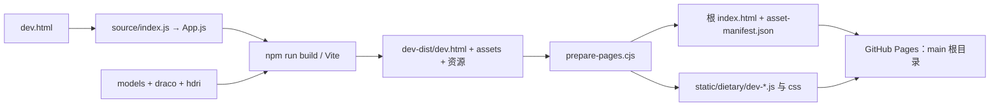

# TCM-3D-web 技术审计与升级计划

审计日期：2026-10-08（Asia/Shanghai）。本轮范围：只读调查、隔离构建、测试和规划；没有修改应用源码、模型、穴位坐标或线上发布配置，没有提交、推送、合并 PR 或部署。

## 1. 项目现状和证据

### 1.1 当前文件夹属于目标仓库，但不能代表当前线上版本

当前工作目录为 `C:\Users\30858\Desktop\TCM-3D-web`。实际存在有效 `.git`，`origin` 为 `https://github.com/GimMoliyadi/TCM-3D-web.git`。

| 基线 | 实际状态 | 审计判断 |
| --- | --- | --- |
| 本地 Git HEAD / 本地缓存的 origin/main | `826b28c9e1b948505be029cb5bddc7b8002d15cc`，2026-06-21 | 旧提交；缓存的远端引用也过时 |
| GitHub 当前 main | `4614879bc908b0b00b8ef4cf52cb2c3e8ec4df17`，2026-09-22 | 比本地 HEAD 多 4 个提交；本轮通过 GitHub API 查询，没有在当前目录执行 pull 或 checkout |
| GitHub Pages 最近成功构建 | 同为 `4614879…`，2026-09-22 09:36 左右（北京时间） | 当前正式站点的审计基线 |
| 本地未提交工作 | 根 HTML、manifest、GLB 已修改，多份旧 bundle 已删除，另有大量未跟踪文件 | `_src/`、微信小程序、辅助脚本等不是当前 HEAD 的受控源码；必须先保全再整合 |

本地 HEAD 的顶层只有 `.nojekyll`、README、HTML、manifest、`models/`、`draco/`、`static/`。远端 main 已增加 `source/`、`dev.html`、Vite 配置、package/lockfile、`hdri/`、`tests/` 和 `docs/`。本地不存在 `source/`、根 `dev.html` 或根 package.json，不能照着远端 README 在当前根目录运行 npm 命令。

远端快照与测试文件放在临时目录，避免覆盖用户工作：

```text
C:\Users\30858\AppData\Local\Temp\tcm-3d-audit-20261008\
  remote\GimMoliyadi-TCM-3D-web-4614879\   # 固定提交快照
  history.git\                          # 隔离的三提交历史，仅供保护测试
  local-cra-build\                      # 本地 CRA 新构建，未覆盖 _src/build
  *-build.log / *-audit.json / *-smoke.log
```

临时证据可能随系统清理而消失；下文固定提交链接与复现步骤用于长期复核。仓库状态依据：[固定远端提交](https://github.com/GimMoliyadi/TCM-3D-web/tree/4614879bc908b0b00b8ef4cf52cb2c3e8ec4df17)、GitHub API `repos/GimMoliyadi/TCM-3D-web/pages` 及 `pages/builds/latest`。

### 1.2 两套工程的技术栈

| 项目 | 远端 main / 正式站源码 | 本地未提交 `_src/` |
| --- | --- | --- |
| 源码 | `source/`，App.js 644 行 | `_src/src/`，App.js 1368 行 |
| 构建工具 | Vite **6.4.1** | react-scripts **5.0.1**（CRA）；没有 Vite |
| React / React DOM | **18.3.1** | 声明 `^18.2.0`，已安装 **18.3.1** |
| Three.js | **0.158.0** | 声明并安装 **0.163.0** |
| React Three Fiber | **8.18.0** | 声明 `^8.16.2`，已安装 **8.18.0** |
| Drei | **9.88.17** | 声明 `^9.105.6`，已安装 **9.122.0** |
| 其他 | GSAP 3.15.0、Lucide 0.468.0、Tailwind 3.4.17 | GSAP 3.15.0、Lucide 1.21.0；另声明 xlsx、Electron 等 |
| 输出 | `dev-dist/`，发布准备后复制到 `static/dietary/` | 默认 `_src/build/`；本轮用 BUILD_PATH 输出临时目录 |
| 完整依赖状态 | 临时目录 `npm ci --ignore-scripts` 成功 | `npm ls --depth=0` 失败：缺 @gltf-transform/cli、electron、electron-builder；网页构建仍成功 |

远端版本来自[package.json](https://github.com/GimMoliyadi/TCM-3D-web/blob/4614879bc908b0b00b8ef4cf52cb2c3e8ec4df17/package.json#L1) 和 lockfile；本地版本来自 `_src/package.json` 与实际 `npm ls`。声明范围、已安装版本与线上版本不可混用。

### 1.3 source、static、index、dev.html 与构建脚本关系

远端实际流程：



- `dev.html` 加载 `/source/index.js`，供 Vite 开发与构建使用。
- `vite.config.mjs` 设置 `base: './'`、`publicDir: false`、入口 `dev.html`、输出 `dev-dist/`；对 `source/*.js` 做 JSX 转换，构建后复制模型、Draco 和 HDR。
- `npm run build` 只生成开发构建目录，不会自动让 GitHub Pages 使用新版本。
- `npm run build:pages` 再执行 `scripts/prepare-pages.cjs`，复制资源并改写根 index 与 manifest；脚本本身不推送，但在 main 提交这些结果后会触发现有 Pages 发布。
- 根 `static/js/main.*` 保留旧版本；当前正式入口已使用 `static/dietary/`。不能凭旧文件仍存在就认定它在执行。
- 本地 `_build*.bat`、`_run_build.js` 使用绝对 Windows 路径，部分关闭 ESLint；`_deploy_load.py` 再复制 `_src/build` 并补写根 HTML，甚至可注入重复预取脚本。这是另一条本地流程，本轮没有运行这些复制脚本。

依据：[vite.config.mjs](https://github.com/GimMoliyadi/TCM-3D-web/blob/4614879bc908b0b00b8ef4cf52cb2c3e8ec4df17/vite.config.mjs#L3)、[dev.html](https://github.com/GimMoliyadi/TCM-3D-web/blob/4614879bc908b0b00b8ef4cf52cb2c3e8ec4df17/dev.html#L1)、[prepare-pages.cjs](https://github.com/GimMoliyadi/TCM-3D-web/blob/4614879bc908b0b00b8ef4cf52cb2c3e8ec4df17/scripts/prepare-pages.cjs#L1)。

### 1.4 GitHub Pages 到底在使用什么

API 实测配置为 `build_type=legacy`、`source.branch=main`、`source.path=/`、HTTPS 已开启，最近构建状态 `built`。Pages 托管的是 main 根目录文件，并不自动运行本项目 Vite 的 npm 构建命令。

当前正式 HTML 与 manifest 引用：

```text
./static/dietary/dev-BJn4gGcL.js
./static/dietary/dev-C2ccZJbu.css
```

从正式站下载的这两个文件与固定远端提交逐字节相同；本轮重新构建的 JS/CSS 也逐字节相同。实际响应头含 `Cache-Control: max-age=600`。因此可以确认：食养模块已经进入正式产物，线上不是本地 `main.f0829766.js` 版本。

依据：[正式站](https://gimmoliyadi.github.io/TCM-3D-web/)、[正式入口](https://github.com/GimMoliyadi/TCM-3D-web/blob/4614879bc908b0b00b8ef4cf52cb2c3e8ec4df17/index.html#L15)、[manifest](https://github.com/GimMoliyadi/TCM-3D-web/blob/4614879bc908b0b00b8ef4cf52cb2c3e8ec4df17/asset-manifest.json#L1)。

## 2. 已完成模块与验证结果

### 2.1 功能完成度

| 模块 | 正式站 / 远端 main | 本地成果及边界 |
| --- | --- | --- |
| 3D 人体、点位、旋转缩放 | 已实现，实际加载与渲染成功 | 本地根产物及新 CRA 构建也能渲染；GLB 不同 |
| 搜索、分类、定位、详情 | 已实现；搜索肝俞、背部分类、详情、ESC 回归通过 | 本地增加经络、功能主题、常用穴位、左右侧等逻辑；分类内容不同 |
| 食养 | 已发布“肝”知识切片；小麦、粳米、牛肉 3 条关系，3 条古籍来源；搜索、原文展开、反向定位、关闭重开可用 | `_src` 没有同一套 Web 食养组件；两套 miniprogram 的食养数据属于微信端，不能计入网站完成度 |
| 食养方 / 五脏全量 | recipes 为 `[]`，尚无食养方；没有其他四脏的完整入口 | 不应把微信端较大数据量当成 Web 功能已经接入 |
| 收藏、学习进度 | 正式 main 无用户同步服务 | `_src/src/utils/learningProgress.js` 有 localStorage 实现；属于本机本浏览器数据，不是账号同步 |
| 错误处理 | 根启动提示、顶层错误边界、独立 HDR 边界已实现 | 本地 CRA 入口没有同等顶层错误边界，需移植已验证能力 |
| 后端 | 当前 main 和本地 Web 应用均未接入 | 另有未合并后端实验 PR，见 3.5 |

食养的 `foodId → relation → anchorAcupointId` 复用肝俞已有坐标，没有另造人体位置；来源记录书名、章节、原文、固定仓库提交、文件 SHA-256、行号及核对限制。这套分离方式值得保留。原文核对不等于现代疗效验证，也不等于纸本校勘。本轮核验其数据结构及展示，不重新背书古籍内容。依据：[食养组件](https://github.com/GimMoliyadi/TCM-3D-web/tree/4614879bc908b0b00b8ef4cf52cb2c3e8ec4df17/source/components/dietary)、[来源记录](https://github.com/GimMoliyadi/TCM-3D-web/blob/4614879bc908b0b00b8ef4cf52cb2c3e8ec4df17/source/data/dietary/dietary_sources.json#L1)。

### 2.2 本轮实际执行的检查

运行环境：Windows，Node 24.14.0、npm 11.9.0；浏览器回归使用本机 Chrome 的无头模式和软件 WebGL。网络命令按仓库要求设置代理。

| 检查 | 结果及限制 |
| --- | --- |
| 远端快照 `npm ci --ignore-scripts --no-audit --no-fund` | 成功安装 169 个包；只在临时目录安装 |
| 远端 `npm run build` | 通过；2168 modules；主 JS 1,302,068 bytes / gzip 365.59 kB，CSS 19,939 bytes / gzip 4.79 kB；有 >500 kB chunk 提示 |
| 远端 `npm run build:pages` | 在临时快照通过；生成相同 JS/CSS，并完成根入口准备；没有修改当前工作目录或线上文件 |
| 远端 `npm test` | **3/3 通过**：旧资产及 290 条数据保护、来源与关系完整性、知识与空间坐标分离 |
| 原有 `tests/browser-smoke.cjs` | **1280×900、390×844 均通过**；三食物、原文、空结果、锚点往返、穴位搜索详情、桌面分类及关闭交互；pageerror 为 0 |
| 正式入口浏览器回归 | 把同一测试临时改为服务仓库根 `index.html`，两视口均通过；不是只测简化的 dev.html |
| 正式入口布局量测 | 桌面 Canvas 920×869.81、面板 360×869.81，位于免责声明下；手机 Canvas 390×404.08、面板 390×371.36，边界相接，无重叠 |
| 线上内置浏览器检查 | 模型可见；肝俞搜索、详情、食养切换与三食物面板可用；检查时无控制台 error/warn |
| 资源故障模拟（本机正式入口） | 模型 404：显示“3D 场景加载失败”与重新加载；HDR 404：Canvas 和主 UI 保留；主 bundle 404：15 秒后显示刷新重试提示 |
| 本地 `_src` 的 `npm run build` | **通过但有警告**：MediaPipe 的 source map 文件缺失；输出临时目录，gzip JS 359.47 kB / CSS 6.64 kB；没有关闭 ESLint 来掩盖失败 |
| 本地根产物与新 CRA 构建 | 各在 1280×900、390×844 初始加载成功，均有 Canvas，pageerror 为 0、HTTP 400+ 为 0；该项没有证明所有本地新功能正确 |
| 本地 5 个 `scripts/test-food-*.js` | **2 通过、3 失败**；测试微信端而非网站，失败均在审计修改前存在，具体见下表 |
| 远端依赖扫描 | 全量 **13**（10 high、3 moderate）；`--omit=dev` **3**（2 high、1 moderate） |
| 本地 `_src` 依赖扫描 | `--omit=dev` **92**（3 critical、71 high、15 moderate、3 low）；包含声明为生产依赖的 CRA 工具链，不能等同于 92 个线上可利用漏洞 |
| 用户产物保护 | 根 index、manifest、GLB 审计前后 SHA-256 相同；已有 Git 跟踪改动列表保持原样 |

本地微信端失败：

| 脚本位置 | 实际失败 |
| --- | --- |
| `scripts/test-food-goal-filter.js:36` | 方向类型计数实际 13，预期 18 |
| `scripts/test-food-safety.js:132` | 主题计数实际 24，预期 29 |
| `scripts/test-food-search-theme.js:79` | 未复核属性返回 `[]`，预期 `凉（待核）`、`甘（待核）` |

通过的两个脚本为 `test-food-content-quality.js`、`test-food-dampness-audit.js`。本轮没有为了通过测试改动微信数据或放宽断言；需要另查实现与预期哪一方已过时。

未验证：实体 iPhone/Android、多点触摸、Safari、低端 GPU、无 WebGL 模式、真实 FPS/显存、Lighthouse/CWV、屏幕阅读器、全部穴位逐个解剖定位、所有网络故障组合。代理环境的成功访问不能证明中国大陆各运营商直连稳定。不能据本次通过的浏览器检查宣布已达到发布验收标准。

## 3. 发现的问题与风险

优先级：**P0 必须修复**（下一轮发布前解决或明确记录受控例外）；**P1 建议优化**（保留现有成果逐步完成）；**P2 未来扩展**（需求成立才做）。

### 3.1 工程与发布

| 优先级 | 问题、证据与影响 | 建议 |
| --- | --- | --- |
| P0 | 本地 Git、未提交 CRA 与远端 Vite 三者漂移；直接 pull、覆盖源码或复制 bundle 都可能丢失成果/退回旧功能 | 先建立两套成果清单和独立备份，固定线上基线；推荐以已复现的远端 Vite 为统一 Web 工程，逐项迁入本地已验证改进 |
| P0 | 远端 README:39 仍写旧 main.ae2dba28.js；source/README 仍称 source 不参与部署；本地 README 更旧 | 统一源码目录、开发/构建/发布命令、资源 base、回滚和版本说明；更新项目级 AGENTS 的适用边界 |
| P0 | 本地 `_src/` 整体未跟踪、当前根缺远端 .gitignore；辅助脚本、node_modules、诊断 public 文件易混入发布 | 分清源码、资产、测试、临时文件和发布产物；采用明确发布白名单，不能直接 git add 全目录 |
| P1 | 根 index 兼任手工壳和发布输出，prepare-pages 使用正则改写；本地另有绝对路径批处理 | 改为唯一 HTML 模板与统一构建入口，在独立输出目录生成部署包；避免开发命令顺便覆盖根正式入口 |
| P1 | 根 preload 硬编码 /TCM-3D-web/，应用使用相对资源 | 统一 base；同时测试仓库子路径和域名根路径，避免自定义域名下 preload 404 或重复下载 |
| P1 | 保留历史 bundle 与两套 Draco 有合理缓存兼容背景，但无明确淘汰政策 | 先建立产物清单与回滚版本，再按缓存窗口清理；本轮不删除 |

文档不一致依据：[README](https://github.com/GimMoliyadi/TCM-3D-web/blob/4614879bc908b0b00b8ef4cf52cb2c3e8ec4df17/README.md#L39)、[source/README](https://github.com/GimMoliyadi/TCM-3D-web/blob/4614879bc908b0b00b8ef4cf52cb2c3e8ec4df17/source/README.md#L3)、[开发记录](https://github.com/GimMoliyadi/TCM-3D-web/blob/4614879bc908b0b00b8ef4cf52cb2c3e8ec4df17/docs/dietary-development.md#L1)。旧文档中的“不发布”是历史阶段描述，后续发布记录已变更；不能把历史描述当成当前状态或本轮发布授权。

### 3.2 穴位数据与分类

原始 JSON 确有 **290 条**，字段为 `id/name/relativePos/location/massage/contraindications/efficacy`。id 与 name 没有精确重复，坐标字段齐全；但“290 条记录”不等于“290 个经审核的独立标准穴位”。

| 优先级 | 发现 | 影响与处理边界 |
| --- | --- | --- |
| P0 | 包含 `Cube.001` 到 `Cube.004`、`xuewei.HighPolyEyes`、`xuewei.HighPolyEyes.001`、`xuewei.sport-briefs01.001` 共 7 个模型节点名；其中一个为零坐标 | 远端直接 map 全部记录渲染，本地已过滤这些名字；应建立“非知识点”标记及视图过滤，原始 290 条与坐标保留归档，不能凭空改成穴位 |
| P0 | 分类表引用 330 个唯一名称，**75 个**无法与原始数据精确匹配 | 界面显示数组长度，渲染时找不到便 return null，造成计数大于可点击项；应有确定 ID 映射与缺失状态，不能生成猜测坐标补数 |
| P0 | `昆仑穴.001/昆仑穴2`、`肩贞穴/肩贞穴2` 等混合表示侧别、重复或模型节点命名 | 增加标准名、别名、侧别与原 ID 映射；人工确认候选，不能简单剥掉数字把不同点位合并 |
| P0 | 本地与远端有 283 条的按摩/功效文字不同，4 条禁忌不同 | 内容整合必须单独审阅，不能把模型/坐标迁移与医疗文字替换绑成一次复制 |
| P0 | 原穴位记录缺逐项来源、审核状态和适用边界，正文仍含具体疾病与按摩/艾灸建议 | 保留原记录作溯源；建立待核状态，优先审查高风险内容。免责声明不能代替逐条内容审查 |
| P1 | 搜索标签写穴名，实际搜 name/location/efficacy；结果读 `text` 字段但数据不存在 | 明确搜索范围，提供真实摘要和空状态；别名/拼音是否接入由使用需求确定 |

坐标范围：x `-10.2909..26.8504`、y `-37.8783..44.6033`、z `-5.0136..17.7675`。范围仅描述现有模型空间，不能作为人体解剖准确性的证明。

本轮按原 id 比较本地与远端：id 集合相同，290 条 relativePos 和 location 均无变化；efficacy 与 massage 各有 283 条变化，contraindications 有 4 条变化。坐标相同也不表示不同 GLB 的材质、包围盒和相机预设可以直接互换。

证据：[分类数据](https://github.com/GimMoliyadi/TCM-3D-web/blob/4614879bc908b0b00b8ef4cf52cb2c3e8ec4df17/source/data/acupoint_categories.js#L3)、[分类查找与列表](https://github.com/GimMoliyadi/TCM-3D-web/blob/4614879bc908b0b00b8ef4cf52cb2c3e8ec4df17/source/App.js#L350)、[直接渲染原始数据](https://github.com/GimMoliyadi/TCM-3D-web/blob/4614879bc908b0b00b8ef4cf52cb2c3e8ec4df17/source/App.js#L204)、本地 `_src/src/App.js:41`。

### 3.3 3D 资源、兼容性和性能

| 资源 | 正式 main | 本地 `_src` / 根目录 |
| --- | --- | --- |
| GLB | 1,868,760 bytes，Draco 压缩，5 个外部 WebP 纹理 | 2,177,204 bytes；内嵌纹理、EXT_texture_webp，与正式模型不同 |
| 纹理 | `models/textures/`，GLB URI 为 textures/...，5 张合计 308,080 bytes | 不可直接套用远端外置纹理流程 |
| Draco | 应用引用 `./draco/`；WASM 285,747 bytes；目录还有 gltf 子目录 | 应用引用 PUBLIC_URL + `/draco/gltf/`；路径与本地 HTML 预取一致 |
| HDR | `./hdri/studio_small_03_1k.hdr`，1,680,234 bytes | 根无该资源，当前 CRA App 也未使用 Environment，不能据此判本地必然缺资源 |

远端 GLB JSON 与外部资源引用只读检查通过；实际 Chromium 解码、纹理渲染成功。没有改动或手工重写 GLB。较老 WebP/WebGL 支持和实体 Safari 尚未验证。

必须保留的正式坐标与相机基线：

```text
targetH = 16
scale = 16 / max(modelBoundingBox.size.y, 0.01)
worldPoint = (relativePos - modelCenter) * scale
模型与点位挂在同一居中/缩放父级
聚焦方向按现有 x/z 判定，相机与 OrbitControls.target 同步做 1.5 秒动画
```

本地新增 POINT_TRANSFORM、深度侧判断及相机预设，不能未经逐点回归替换正式公式。相机优化应调整构图与交互，不改变点位原坐标。依据：[CameraController](https://github.com/GimMoliyadi/TCM-3D-web/blob/4614879bc908b0b00b8ef4cf52cb2c3e8ec4df17/source/App.js#L19)、[模型居中缩放](https://github.com/GimMoliyadi/TCM-3D-web/blob/4614879bc908b0b00b8ef4cf52cb2c3e8ec4df17/source/App.js#L177)。

P1 优化项：约 1.30 MB 主 JS、1.68 MB HDR、点位独立 mesh/动画都需要性能测量；按测量结果拆分食养或非首屏 UI、限制移动端 DPR、停止不可见/非选中点的连续动画。先保留 Three/R3F/Drei 配套版本，再小步升级并回归。不要为了消除 chunk 警告把阈值调大来当作性能优化。

### 3.4 UI/UX、移动端和可访问性

- 正式食养模块已有桌面侧栏、手机下部面板；本轮两视口布局和回归通过，具有复用价值。
- 正式 OrbitControls 采用 CAD 鼠标习惯：左键平移、中/右键旋转。面向公众时与“拖动旋转”的直觉不一致，触屏手势也需单独说明。现有功能保留，可提供明确的操作模式切换。
- 本地手机初始分类抽屉覆盖大部分 3D 区域，且与顶部搜索区域重叠；需要明确首次进入默认状态、收起路径和底部按钮位置，不能直接宣称新版移动体验更好。
- 部分图标按钮缺可访问名称；穴位搜索结果使用可点击 div，键盘操作与焦点反馈不足。食养卡片的语义 button 与搜索 label 较完整，可作为统一模式。
- 原 App 把 `onPointerMissed` 放在普通 div 上；“点击背景关闭详情”的文案与 R3F miss 事件挂载不一致，应补实际交互测试再修正。关闭按钮、ESC 与背景行为应一致。
- 手机横屏、浏览器地址栏变化、安全区、软键盘、长文字滚动、模式切换后的焦点恢复、减少动态效果都需要专门验收；仅有 390×844 截图不足以覆盖。

依据：[App.js:569](https://github.com/GimMoliyadi/TCM-3D-web/blob/4614879bc908b0b00b8ef4cf52cb2c3e8ec4df17/source/App.js#L569) 及本轮本地手机截图 `local-5197-390.png`。前述交互/布局问题未在本轮直接修复。

### 3.5 后端、API 与部署配置的实际边界

**当前 main 和本地 Web：没有 FastAPI、SQLite 数据库、Uvicorn 服务、运行时业务 API 调用或后端部署配置。** 穴位与食养 JSON 由 import 打进前端；模型等静态资源下载不是业务 API。localStorage 收藏也不是服务端持久化。

**仓库另有后端实验：**开放的 [PR #1：feat: 添加 FastAPI + SQLite 穴位后端实验](https://github.com/GimMoliyadi/TCM-3D-web/pull/1)，分支 `feature/sqlite-fastapi-backend`，不在当前 main/Pages 中；查询时两个 `test` checks 为 FAILURE。GitHub workflow 列表中的 “Backend tests” 来源于这一实验，不能据此推定主站已运行后端。本轮没有合并、部署或把实验当作可用基础服务。

PR 的固定 head 为 `ebf9f96f4e1d43172236c873552cdbf04972e86c`。只读审查确认它已包含数据库、迁移、FastAPI 入口、requirements、API 测试与 CI：

| 实验内容 | 实际实现与缺口 |
| --- | --- |
| 数据迁移 | JSON → SQLite 单表 acupoints，保留 source_id、名称、坐标和文字字段；CI 的迁移与 290 条计数已通过 |
| GET /api/acupoints | 一次返回全部记录，未做分页或响应模型 |
| GET /api/acupoints/{acupoint_id} | 使用 SQLite 自增整数；与原 JSON 中文字符串 id 不同，接入前必须统一身份映射 |
| GET /api/search?q= | 对 name/location/efficacy 使用 LIKE 检索；未接到 React |
| API 测试 | 测试代码涵盖迁移计数、ID=1、百会搜索、404；CI 尚未运行到这些断言 |
| 部署 | 没有后端生产托管、反向代理、持久盘、备份或迁移版本方案；没有配置跨域访问 |

失败证据：PR run `34871045170` 和 push run `34871024076` 均在 `pytest -q backend/tests` 收集阶段报 `ModuleNotFoundError: No module named 'backend'`，退出码 2。候选修复为在仓库根运行 `python -m pytest -q backend/tests` 或正确设置导入路径，仍需实际重跑，不能据此宣布 API 已通过。本轮读取源码与 CI 日志，没有本地启动该 PR 服务。若前端和 API 分域再配置明确 CORS 白名单；采用同域反代可避免额外跨域配置。公开只读接口不必为了技术栈新增账号，未来写接口则必须有认证授权。

依据：[后端实验入口](https://github.com/GimMoliyadi/TCM-3D-web/blob/ebf9f96f4e1d43172236c873552cdbf04972e86c/backend/main.py#L1)、[后端测试](https://github.com/GimMoliyadi/TCM-3D-web/blob/ebf9f96f4e1d43172236c873552cdbf04972e86c/backend/tests/test_api.py#L6)、[失败 CI](https://github.com/GimMoliyadi/TCM-3D-web/actions/runs/34871045170)。后端规划应先复核该实验的可复用部分，避免重复建设或直接接入未通过测试的实现。

### 3.6 安全与测试缺口

- **P0：依赖通告需要处理，但不能夸大可利用性。** 远端生产依赖扫描涉及 Drei → lodash.pick（原型污染通告）及 uuid；未确认应用把攻击者可控路径传入这些函数。Vite、PostCSS、Tailwind 等通告多涉及开发服务器、构建输入或工具链，静态 Pages 不运行 Vite 服务。开发命令目前绑定 127.0.0.1，应继续避免对公网暴露。
- 远端全量扫描建议 Vite 修复版为 6.4.4、Drei 为 9.122.0；这是审计日扫描结果，不是已完成升级，也不保证一次升级消除全部问题。先读兼容性与锁文件差异，逐包验证，不运行 `npm audit fix --force`。
- 本地 `xlsx` 0.18.5 有 high 通告，源码未发现使用；CRA 被列为 dependencies 导致 `--omit=dev` 仍统计大量开发链漏洞。应先删除确认不用的依赖、统一工程并正确区分构建与浏览器运行依赖，避免照数字盲目升级到不兼容版本。
- 未发现当前业务需要登录、密钥或写接口；这不等于进行过完整秘密扫描或证明代码绝无 XSS。React 文本渲染为主；根启动兜底使用 innerHTML 拼接错误消息，后续应改成 DOM/textContent 安全输出。
- 正式响应有 HTTPS/HSTS，未观察到 CSP 等细化策略；后续以实际 Worker/WASM、内联脚本与资源需求制定 CSP，不能套用阻断解码的通用模板。本地 Google Fonts 引用会引入额外外网依赖，正式当前路径没有此依赖。
- 本地 public 有 GLB 检查页、原型 HTML、Python 探针及 dump JSON，CRA 会原样复制；虽未证明含机密，也不该默认进入公开站部署包。
- 模型自带 `models/license.txt`，记录 Navirobot 的 Sketchfab Base Mesh 和 CC-BY-4.0；升级和重新分发必须保留署名、来源、许可证及修改说明。HDR 在 README 标为 Poly Haven CC0，但缺独立许可记录；发布前补齐来源证据。没有根 LICENSE 不代表模型没有许可，也不代表全仓代码和知识材料可任意再许可。
- 远端只有 3 个单元测试，保护测试硬依赖历史提交 b569fa1 的 `git show`；普通 ZIP 或浅克隆不一定能运行。本轮通过隔离历史补足。CI 需明确拉取历史或改为版本化保护清单。
- 缺分类引用、数据 schema、相机数值、真实点选、无 WebGL、资源失败、键盘与发布路径自动检查；原 browser-smoke 未列为 npm test 的一部分，Playwright 也未作为项目测试依赖锁定。

安全通告依据：[Vite 开发服务路径处理通告](https://github.com/advisories/GHSA-4w7w-66w2-5vf9)、[lodash 原型污染通告](https://github.com/advisories/GHSA-p6mc-m468-83gw) 及临时目录 npm audit JSON。只做依赖与代码边界审查，没有对正式站进行攻击性测试。

## 4. 推荐目标架构

### 4.1 近期：保留静态架构，统一到已验证的 React + Vite + Three.js

推荐以远端 `source/` Vite 工程为基线，保留现有食养与错误边界；将本地导航、过滤、收藏等按功能逐项迁入。当前工作区按 AGENTS 要求以 `_src/` 为本地编辑源，本轮未绕过；下一阶段建立统一工程时，应同步修改指引，避免“两份源码都是真相”。无需现在全面改 TypeScript、状态管理、路由或目录命名。

```text
浏览器
  React UI：搜索 / 分类 / 详情 / 食养 / 学习入口
  R3F + Drei：场景 / 模型加载 / 点位 / 相机控制
  独立知识数据与校验：穴位 / 分类映射 / 食物 / 来源 / 审核状态
  静态资产：GLB / Draco / HDR / 纹理
          ↓
  唯一构建产物 dist（建议后续名称），供静态托管
```

只在明确边界处拆 App：`ModelScene`、`CameraController`、`AcupointSearch`、`CategoryPanel`、`AcupointDetail`；保留已有食养组件。现有状态不复杂时继续用 React state，不为架构图添加新框架。

### 4.2 数据结构升级

保留原始记录与空间映射，新增知识层，不直接重写坐标：

| 实体 | 建议字段及约束 |
| --- | --- |
| 穴位知识 | 稳定 id、标准名、原名/别名、经络、部位、定位描述、来源引用、审核状态、版本与复核日期 |
| 空间点位 | 原 id、modelVersion、coordinateSpace、原 relativePos、侧别、关联知识 id；同名双侧点位各自保留 |
| 分类 | 以确定 id 引用点位/知识；计数从实际可展示项派生；缺资料项明确显示“待补充”或暂不发布 |
| 来源 | 书名/版本/章节/页或行号、固定 URL/提交、必要原文、校验摘要、版权与许可、复核者、证据边界 |
| 食养关系 | foodId、传统知识目标、anchorPointId、sourceIds、关系说明、confidence/reviewStatus；继续不复制坐标 |
| 免责声明 | 内容类型、版本、适用页面、更新时间；全局短说明与具体条目的风险边界各司其职 |

先加入 schema/校验和兼容映射，再分批规范化。原文证据、传统理论、现代研究、使用建议分别标明，不能从传统关联自动推导现代治疗结论。无来源内容保持待核；需要人工专业复核的任务不能用自动校验冒充完成。

### 4.3 FastAPI + SQLite 的接入条件

| 实际需求 | 是否需要后端 |
| --- | --- |
| 展示 290 条记录、3D 定位、静态食养阅读、浏览器本地收藏 | 不需要；静态数据足以满足 |
| 内容较多但由开发者批量维护 | 优先离线校验并导出静态 JSON，仍不必运行服务 |
| 多人在线编辑/审核、无需重建更新内容、多个客户端共享数据 | 可以引入 FastAPI + SQLite，先做只读知识接口 |
| 账号、跨设备收藏与进度 | 需要额外认证、授权、隐私与备份设计；不能因为 SQLite 已建表就认为同步已完成 |

需要时的最小架构：静态前端与资源继续走静态服务；同域 `/api/v1` 由 FastAPI 提供分页/检索/详情/来源接口；SQLite 文件置于同机持久盘，带迁移、事务与备份恢复演练。初期不公开写入接口。前端显式显示加载、空结果、失败与重试，保持模型浏览不依赖 API 响应；数据版本明确，避免默默混用新旧记录。

SQLite 适合这类读多写少、单实例应用；多实例共享网络文件、频繁并发写不适合作为起点。不能部署到会随函数结束消失的临时文件系统。只有真实并发/多实例需求出现再评估 PostgreSQL。依据：[FastAPI SQL 官方教程](https://fastapi.tiangolo.com/tutorial/sql-databases/)、[SQLite 使用边界](https://www.sqlite.org/whentouse.html)。

## 5. 分阶段升级任务与验收标准

工期为单人、熟悉当前项目后的粗估，不含人工知识审校、备案等待和用户验收；不是实施承诺。本轮只交付本计划。

| 阶段 | 优先级与任务 | 验收标准 | 粗估 |
| --- | --- | --- | --- |
| 0：审计与决策（本轮） | 固定线上/本地基线、隔离构建、测试与风险记录 | 本文可读；线上产物可复现；已有本地资产未覆盖；用户选择下一阶段 | 已完成本轮工程审计，保留明确未验证项 |
| 1：工程基线统一 | P0：保全本地成果；建立与远端固定提交一致的隔离开发基线；明确唯一源码；统一 Node/npm/lockfile、开发/构建命令、ignore、HTML 模板与发布包；补 README；按兼容性修复依赖通告 | 全新检出可 npm ci、build、test；模型和坐标保护通过；现有线上 JS/CSS 在升级前可复现；本地功能差异有逐项取舍清单；单条命令生成独立可预览发布包，不修改线上 | 2–4 人日 |
| 2：数据与内容边界 | P0：处理非穴位节点、75 个分类引用不匹配、别名/侧别映射；校验 schema、稳定 id、来源和状态；高风险文字先审查 | 所有发布分类均能解析确定 id，显示数量与列表一致；原始 290 条、GLB 与坐标留有可核验基线；不编造缺失坐标；未审内容有明确状态，古籍关系有来源与限制 | 3–6 人日，内容审核另计 |
| 3：手机与桌面体验 | P1：保留视觉语言；整合本地有价值导航；适配抽屉/详情/搜索/软键盘；触摸与鼠标模式；键盘/焦点/标签；相机回归；根据测量优化加载/DPR/动画 | 360/390/768/1280 宽度与横屏无文字控件重叠；实体 Android Chrome + iPhone Safari 完成同一操作流程；前后左右及边缘点位聚焦正确；空/慢/错状态可操作；不修改原坐标；见下述性能预算 | 4–8 人日 |
| 4：测试门禁与部署候选 | P0 门禁 + P1 部署：把数据、资产保护、浏览器、故障与正式入口测试接入 CI；对比大陆访问；生成预发布包、版本清单与回滚说明 | 单元/构建/资源引用/两视口回归全部通过；以真实运营商直连测候选地址；预算与备案条件明确；同一产物通过预览与待发布验收；生产变更仅在用户明确授权后执行 | 2–4 人日，备案另计 |
| 5：后端（条件成立后） | P2：复核 PR #1、先修测试；按真实需求做只读 FastAPI、SQLite 导入/迁移/查询；需要时再增加管理审核与账号 | API 合同测试通过；290 条原 id/坐标不漂移；404/超时/空结果/版本一致性通过；SQLite 重启持久化与备份恢复验证；写接口有认证授权后才开放 | 4–8 人日，仅只读 API；账号/管理另估 |
| 6：知识拓展 | P2：其他藏象、食物与食养方、分享链接/学习路径 | 每条新增内容经来源与人工审核门禁；锚点只是导航，不能冒充现代器官作用；新增条目不降低既有质量标准 | 按内容批次评估 |

建议阶段 3 的性能验收预算：固定设备/网络条件，记录冷缓存与热缓存；目标中端实体手机常用交互保持 ≥30 FPS、无 WebGL context 丢失；在约定的 10 Mbps/100 ms 测试网络下首个可交互 3D 目标 ≤8 秒；核心路径无错误请求。它们是待验证目标，不是本轮测得结果。LCP/INP/CLS 与模型可交互时间分别记录，不能用 2D 页面分数代替 3D 体验；达不到预算时先定位下载、解码、GPU 或渲染瓶颈。

发布验收矩阵至少包括：首次/缓存加载、模型/纹理/Draco/HDR/JS 失败、无 WebGL、穴名与描述搜索、空结果、每类抽样、重复侧别、3D 点选、详情关闭、重置、连续快速选点、食养三条与来源、键盘操作、触摸缩放旋转、手机横竖屏及正式子路径。每阶段保留小而完整的回归，不能靠删除失败测试放行。

## 6. 部署选型与成本对比

价格与平台限制查询日期为 2026-10-08。以下区分官方报价与预算估算；域名、备份、超额流量、税费、人工维护另计。尚未购买或开通任何服务。

| 方案 | 费用依据 / 初期预算 | 中国大陆访问与维护 | 适用建议 |
| --- | --- | --- | --- |
| 继续 GitHub Pages | 公共仓库可用免费 Pages；站点 ≤1 GB、带宽软限制 100 GB/月 | 维护成本最低；境外链路，不能承诺大陆直连稳定；无法运行 FastAPI | 继续保留现有公开版本，适合当前学习展示与海外/备用入口。限制依据：[GitHub 官方](https://docs.github.com/en/pages/getting-started-with-github-pages/github-pages-limits) |
| Cloudflare Pages 静态站 | 静态请求免费；免费计划 500 构建/月，单文件 ≤25 MiB；模型目前远小于限制 | 低运维、预览方便；免费全球网络不是大陆企业网络，不保证大陆稳定；Python + SQLite 后端需另处部署 | 可作开发预览/海外候选，不应把它当大陆稳定性的自动解决方案。[静态计费](https://developers.cloudflare.com/pages/functions/pricing/)、[限制](https://developers.cloudflare.com/pages/platform/limits/)、[中国网络另购条件](https://developers.cloudflare.com/china-network/) |
| 腾讯云轻量对象存储静态资源 / OSS、COS + 国内 CDN | 腾讯北京等区域示例：存储约 0.118 元/GB/月、直出流量 0.5 元/GB；10 GB/月直出约 5 元 + 存储/请求费。完整自定义域名/CDN方案先预算约 10–50 元/月，属于估算 | 内地节点更适合大陆受众；域名/产品接入与备案条件要先确认；CDN回源与边缘流量分别核算，不能套用直出单价 | 当前纯静态主站的优先商业托管候选，无需为部署增加后端。[腾讯报价](https://cloud.tencent.com/document/product/1207/88189)、[OSS计费构成](https://help.aliyun.com/zh/oss/billing-overview) |
| 国内轻量服务器统一托管静态站 + API | 腾讯官网入门 2核2GB/3Mbps/200GB 月流量示例 **45 元/月或459元/年**；域名/备份/超额另计 | 需备案及系统更新、HTTPS、备份、监控；3Mbps 首次分发模型可能受限，可按测量加 CDN | 仅当确需 FastAPI/SQLite 时考虑，单机易维护但需真实恢复方案。[官方套餐](https://cloud.tencent.com/product/lighthouse) |
| 香港或其他境外 VPS | 先预留约 50–150 元/月，**预算占位范围，非已核实套餐报价**；采购前按地区与线路询价 | 通常省去内地节点接入流程，但跨境延迟/丢包仍需测量；同样承担服务器运维 | 作为备案未就绪时的候选；不能用“香港”标签代替大陆运营商测量 |

估算基础：若每次冷访问约下载 5–6 MB 资源，1000 次完全冷访问约 5–6 GB；这是按文件体积推算，实际受 gzip、缓存、HDR 是否加载与重复请求影响。应通过网络记录测得单次有效传输量后核算。腾讯示例单价只适用于对应产品/地域，不能直接套到所有 OSS/COS/CDN。

内地服务器与内地/全球 CDN 的域名备案要求应在具体方案确定后复核；上线前向服务商确认中医科普内容对应的接入审核要求，不在本轮推定需要哪种许可。依据：[阿里 CDN 接入与备案说明](https://help.aliyun.com/zh/cdn/getting-started/getting-started)。

推荐决策：近期维持当前 Pages，先做隔离开发与质量门禁；如果主要用户在大陆，优先测试国内静态托管 + CDN，并测电信/联通/移动至少两种实际网络。API 需求成立后再加国内持久化单机服务，尽量同域反代 `/api`，减少跨境链路和不必要 CORS。

自动化发布建议：PR 只运行校验/构建/浏览器测试，保存可审阅产物；预发布与生产配置分开；生产采用显式手动触发和受保护环境，发布前确认用户授权。版本清单记录源码提交、数据版本、资产摘要、测试结果；hash 资源长缓存、HTML 短缓存；同一构建产物发布并保留上一可用版本。GitHub Pages 不提供任意后端能力，不能把 SQLite 文件作为公开静态文件发布。

## 7. 推荐的第一批开发任务

推荐下一阶段选择 **“工程基线统一 + 数据引用修复”**，先不建设后端，不整体改 3D 或 UI。

1. **保全与对齐基线**：完整保留本地 `_src`、模型、小程序及未提交工作；在隔离目录建立远端 4614879 基线，列出可迁移功能、文案和资产差异。本轮不要求对脏工作区执行 pull/reset。
2. **统一构建与文档**：明确使用 Vite/source；建立独立部署输出、HTML 模板和资源 base；补本地启动、完整安装、构建、测试说明及 ignore，去除发布包里的探针和原型页。
3. **先补数据回归再修引用**：校验 290 原始记录、非知识点、75 缺失分类名、侧别映射、来源引用。分类数量与实际结果一致；未知位置保持待补，不猜坐标。
4. **处理依赖风险**：优先兼容修复 Vite/Drei/构建链，清理确认未使用的 xlsx/Electron 网页依赖；保留相机与资源回归；不一口气升级 React/Three/R3F 大版本。
5. **统一知识边界**：整理本地与远端文案差异，优先审查具体疾病和操作建议；展示来源/待核状态及适用免责声明。
6. **固定最小验收门禁**：让 unit/build/browser-smoke 一次命令或 CI 可执行；同时测试 dev 与正式模板、桌面/手机、资源失败。先验证现有体验，再选择导航/触摸优化。

这批任务的交付应是可本地预览、可审阅差异、可回归的开发版本及说明。用户接受后才能单独讨论发布；不能把构建通过当成上线授权。

## 8. 复现检查与证据索引

### 8.1 远端固定基线

在独立的新目录获取仓库，不在当前脏工作区覆盖；确保含保护测试使用的 `b569fa1b52a8cef4329a6e801564ce5fce580ac7` 历史。Windows 外网命令前先设置代理：

```powershell
$env:HTTPS_PROXY = 'http://127.0.0.1:7897'
$env:HTTP_PROXY = 'http://127.0.0.1:7897'
$env:ALL_PROXY = 'socks5://127.0.0.1:7897'
# 以下只在独立检出的 4614879 基线目录执行
npm ci --ignore-scripts --no-audit --no-fund
npm test
npm run build
npm audit --json
npm audit --omit=dev --json
```

`npm run build:pages` 会改写该目录根 index、manifest 和 static/dietary，仅在隔离副本检查；它不等于部署。本轮临时快照保护测试使用 `$env:GIT_DIR` 指向临时 bare 历史，因此 ZIP 环境也能读取基线。

浏览器脚本依赖 Playwright + Python + Chromium。本轮复用工具运行时的 Playwright 和已安装 Chrome，通过 `PLAYWRIGHT_MODULE`、`CHROMIUM_PATH` 指定，没有给仓库新增 Playwright 依赖。默认浏览器缺失的首次启动失败后改用现有 Chrome，正式结果通过；没有把环境失败当成功。

```powershell
# 在配置好上述浏览器依赖的独立基线中
node tests/browser-smoke.cjs
# 启动的是本机 5199 服务，脚本结束会停止服务器
```

源码测试覆盖依据：[dietary.test.cjs](https://github.com/GimMoliyadi/TCM-3D-web/blob/4614879bc908b0b00b8ef4cf52cb2c3e8ec4df17/tests/dietary.test.cjs#L1)、[browser-smoke.cjs](https://github.com/GimMoliyadi/TCM-3D-web/blob/4614879bc908b0b00b8ef4cf52cb2c3e8ec4df17/tests/browser-smoke.cjs#L1)。

### 8.2 本地工程与数据复核

```powershell
# 在当前 _src/ 中，使用新临时输出目录，保留原 build/ 与根产物
$env:BUILD_PATH = Join-Path $env:TEMP 'tcm-3d-audit-20261008/local-cra-build'
npm run build
Remove-Item Env:BUILD_PATH

# 在 source/ 对应的独立远端基线根目录检查
$points = Get-Content -Raw source/data/acupoints_data.json | ConvertFrom-Json
$points.Count
$points | Group-Object id | Where-Object Count -gt 1
$points | Group-Object name | Where-Object Count -gt 1
```

主要临时日志：`remote-build.log`、`remote-pages-build.log`、`remote-tests.log`、`remote-browser-smoke.log`、`formal-browser-smoke.log`、`failure-audit.log`、`local-build.log`、`local-browser-audit.log`、`remote-npm-audit.json`、`remote-runtime-audit.json`、`local-runtime-audit-retry.json`。浏览器截图在临时快照 `.test-output/`、`.test-output-formal/` 及临时目录 `local-*.png`。

ChatGPT 协作技能已加载，但首次连接方式尚待用户选择，没有建立连接，也没有声称获得 ChatGPT 网页端复核。本报告来自本地执行、GitHub/线上只读核验和并行技术审计。

**下一步停在用户选择：**可以选择阶段 1 工程统一、阶段 2 数据质量、阶段 3 交互优化，或先独立复核后端实验。本轮没有擅自开始这些开发或发布任务。
